<p align="center">
  <picture>
    <source media="(prefers-color-scheme: dark)" srcset="assets/branding/mend-logo.svg">
    
  </picture>
</p>

<p align="center">
  <b>Free, open-source audio repair and restoration.</b><br>
  A spectral editor and thirteen repair plugins for Windows, macOS and Linux.
</p>

<p align="center">
  <a href="https://github.com/LukeHarrison1990/mend/actions/workflows/build.yml"></a>
  <a href="LICENSE"></a>
  
</p>

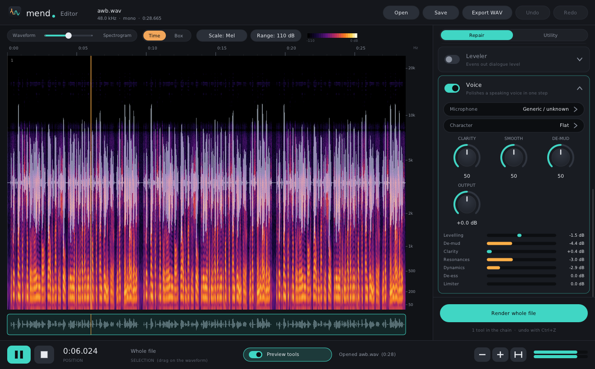

Mend fixes the everyday problems in recordings: hiss, hum, clicks, crackle,
clipping, plosives, sibilance, breaths, wind, room reverb and uneven levels,
and its **Voice** tool polishes a speaking voice in one step, with presets
for popular microphones.
Every tool works three ways:

- inside the **Mend Editor**, where you open a file, see it as a waveform
  and spectrogram, select (or box-select) the problem and repair it;
- as a **plugin** (VST3, CLAP, LV2, and AU on macOS) in your DAW or editor;
- as a small **standalone app** that processes live audio.

All the DSP is written from scratch in plain C++ and shared by all three.

**Website:** [lukeharrison1990.github.io/mend](https://lukeharrison1990.github.io/mend/)

> **Status:** early but usable (0.8). Tested on Windows and Linux; the macOS
> build compiles in CI but hasn't been tried on a real Mac yet. Feedback and
> bug reports are very welcome.

## Download

Get the latest build for your system from the
[Releases page](https://github.com/LukeHarrison1990/mend/releases):

- **Windows:** `Mend-<version>-windows-setup.exe`, an installer that shows
  the licence and lets you choose what to install: the editor, the
  standalone apps, and the VST3, CLAP and LV2 plugins separately (so you
  can install, say, only the VST3s). It installs plugins to the standard
  shared folders, adds Start-menu shortcuts and an uninstaller, and can
  open `.mend` projects with the editor.
- **macOS:** `Mend-<version>-macos.pkg`, an installer with the same choices
  (plus Audio Units). Click **Customise** on the Installation Type page.
- **Linux:** `Mend-<version>-linux.tar.gz`, with an `install.sh` that copies
  everything into your home folder.

There's also a plain `.zip` for Windows and macOS if you'd rather copy files
by hand: see [Installing the plugins](#installing-the-plugins) below.

The builds aren't code-signed yet. On Windows, SmartScreen may warn the
first time ("More info", then "Run anyway"). On macOS, right-click the
installer and choose **Open** the first time.

## Mend Editor

The standalone app for repairing whole files:

- **Open** WAV, AIFF, FLAC, MP3, Ogg Vorbis, Opus, AAC and ALAC (.m4a), plus
  WMA on Windows and CAF on macOS (any sample rate, any channel count);
  **export** WAV at 16 or 24-bit (with TPDF or noise-shaped dither) or
  32-bit float. You can also pass a file on the command line.
  AAC, ALAC and WMA use the operating system's decoders; on Linux they need
  FFmpeg installed.
- **Waveform and spectrogram views** per channel, with a time ruler, an
  overview strip and a level (dB) or frequency (Hz) scale. A slider blends
  smoothly from the waveform alone, through the waveform drawn over the
  spectrogram, to the spectrogram alone. The spectrogram's frequency scale
  can be Mel, Log or Linear, and its range 80 to 140 dB.
- Mouse wheel zooms around the pointer, Shift+wheel (or a sideways wheel)
  scrolls, the overview scrolls by click or drag, and zoom right in to see
  individual samples. Views are drawn once into cached images wider than
  the screen, so dragging a selection and scrolling stay smooth on 4K
  screens, even with hour-long files.
- **Opening** large files happens in the background, with a progress bar
  and Cancel.
- **Projects:** Save (Ctrl+S; Ctrl+Shift+S to save as) writes a `.mend`
  project with the audio exactly as it stands and every setting: the
  repair chain, the utility modules, the view and the selection. Open it
  again later to carry on. If you close the window or open another file
  with unsaved changes, Mend asks whether to save them first.
- **Selection:** drag on the waveform; Shift+click extends; drag either edge
  to adjust; Esc clears; Ctrl+A selects all.
- **Spectral selection:** with the spectrogram showing, pick the **Box**
  tool (or press B; T goes back to Time) and drag a box over a range of
  time *and* frequency. Rendering the repair chain then changes only what's
  inside the box, and **Spectral Repair** can attenuate it to match the
  audio either side, replace it from that audio, or change its gain.
- **Repair tab (the chain):** fourteen tools, each with its own switch, so
  any combination runs together, top to bottom in a restoration-friendly
  order. Click a tool's name to show its controls.
- **Controls that move on their own:** while you preview, a control under
  automatic control (De-hum's frequency while it tracks the hum, De-clip's
  threshold while it finds the clip level) turns amber, shows AUTO and
  follows what was detected; grab it to take over from that value. Tools
  that work dynamically show live meters of what they are doing right now.
- **Utility tab (one-shot modules):** each has its own Apply button and
  works on the selection (or the whole file). See the second table below.
- **Preview:** Space plays the selection (or from the cursor) through the
  enabled tools, live; knob changes are heard straight away. Switch
  "Preview tools" off to hear the file as it is.
- **Render** applies the chain to the selection, or the whole file if nothing
  is selected, in the background with a progress bar and Cancel. Edges of a
  partial render are crossfaded, latency is compensated, and each tool gets
  a warm-up run so the first second is processed as well as the rest.
- **Undo / redo** every render (Ctrl+Z, Ctrl+Y or Ctrl+Shift+Z).
- **Learn noise from selection** (De-noise): select a stretch of noise only,
  learn it, then render the rest with that fixed profile.
- Keyboard: Ctrl+O open, Ctrl+S save project, Ctrl+E export WAV, Ctrl+R render, Home, + / - / F zoom,
  B / T box or time selection, Esc clears the selection (or cancels a job).

| | |
|---|---|
| 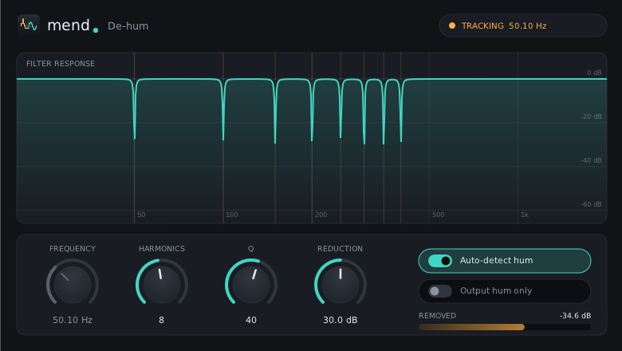 | 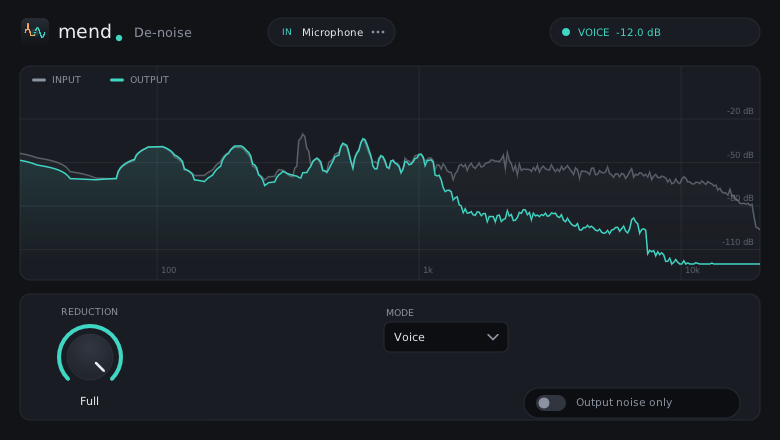 |
| 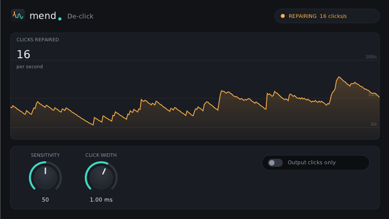 | 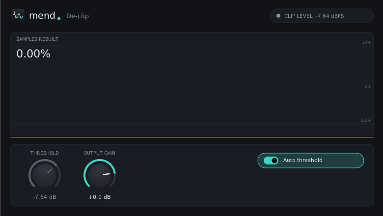 |
| 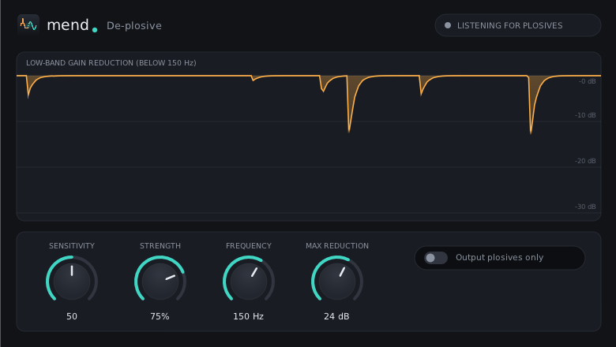 | 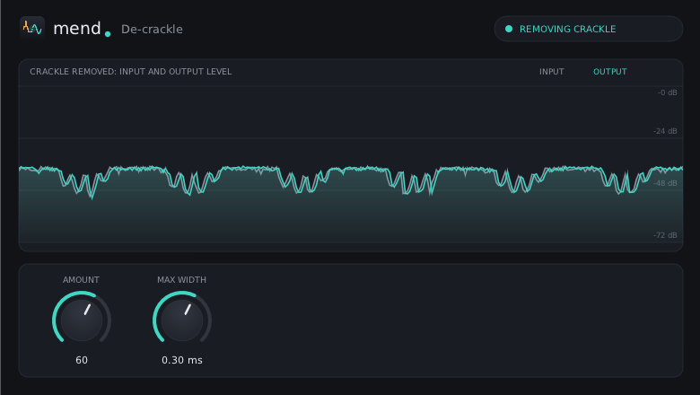 |
| 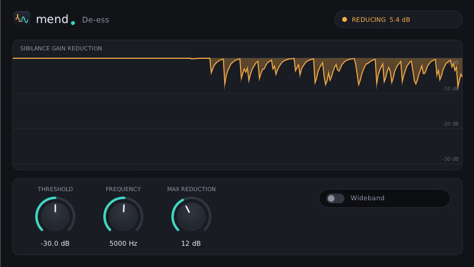 | 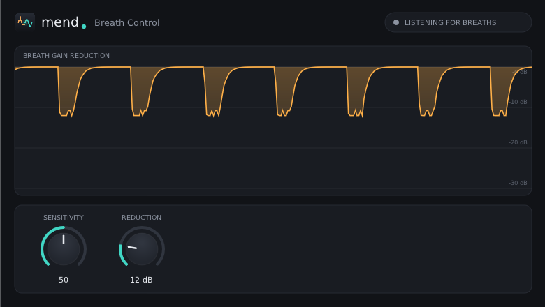 |
| 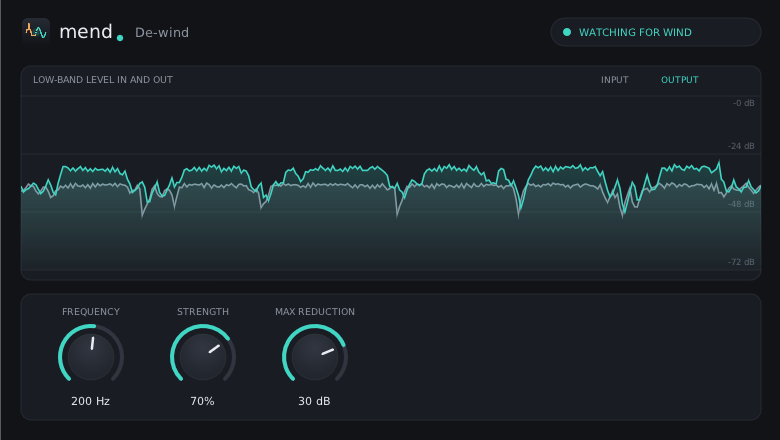 | 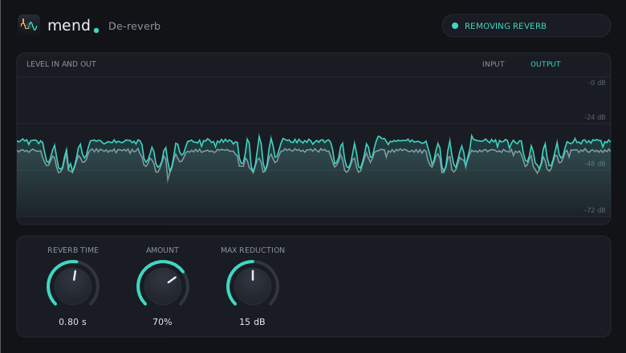 |
| 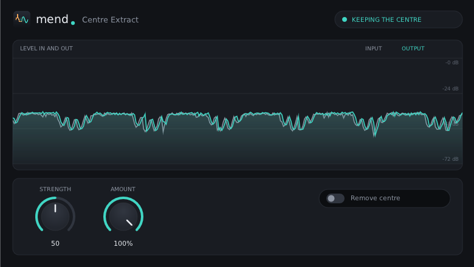 | 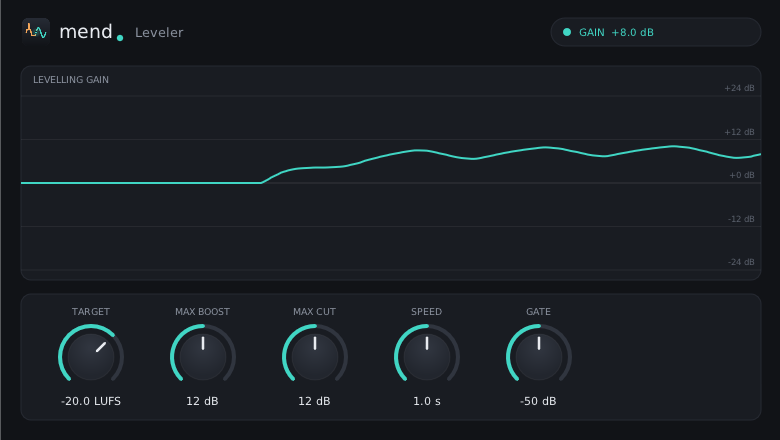 |
| 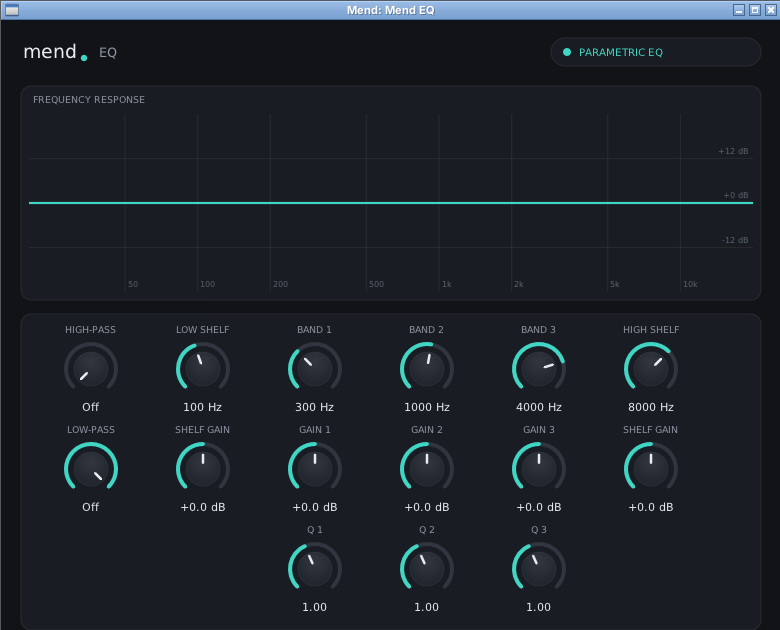 | 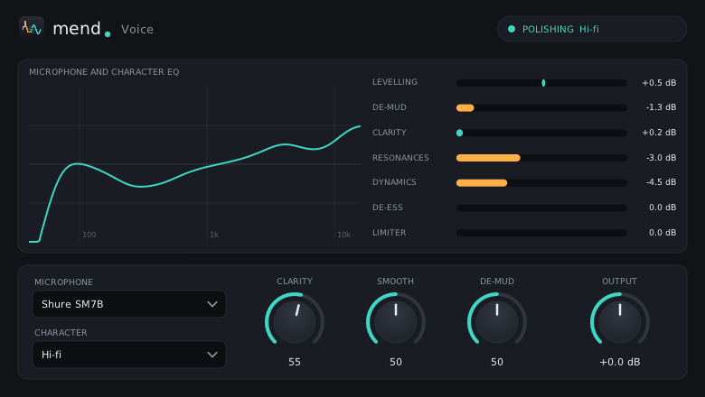 |

## Tools

Repair tools. In the editor they run together as a chain; each is also a plugin and a standalone app:

| Tool | Since | What it does |
|---|---|---|
| **De-clip** | 0.2 | Rebuilds the flattened peaks of clipped audio |
| **De-click** | 0.2 | Removes clicks and pops; protects real transients |
| **De-crackle** | 0.6 | De-click tuned for dense, tiny clicks (vinyl crackle, mouth clicks) |
| **De-hum** | 0.2 | Removes mains hum (50/60 Hz) and its harmonics; auto-tracks drift |
| **De-wind** | 0.6 | Pulls down low-frequency rumble that rises far above the band just above it |
| **De-plosive** | 0.2 | Tames p/b pops in speech without touching the voice |
| **Spectral De-noise** | 0.3 | Learns or tracks steady broadband noise (hiss, air-con, fans) and removes it |
| **De-reverb** | 0.6 | Predicts each bin's late reverb from its own past (Lebart's method) and removes it |
| **Breath Control** | 0.6 | Finds unvoiced, noise-like, quieter-than-speech frames and turns them down |
| **De-ess** | 0.6 | Split-band (or wideband) sibilance reduction with look-ahead |
| **Centre Extract** | 0.6 | Keeps or removes what both stereo channels share |
| **EQ** | 0.6 | High-pass, low shelf, three peaking bands, high shelf, low-pass |
| **Leveler** | 0.6 | Slow K-weighted gain riding towards a loudness target |
| **Voice** | 0.8 | One-step speech polish: microphone correction, clarity, smoothing, de-mud, resonance smoothing, de-ess and limiting, with presets for 28 microphones |

Utility modules (editor only):

| Module | What it does |
|---|---|
| **Spectral Repair** | Attenuate, replace or change the gain of a time-frequency box |
| **Interpolate** | Rebuilds a selection up to 100 ms from the audio around it (AR interpolation) |
| **Gain**, **Normalize**, **Fade** | Level changes, peak normalising (with DC removal), five fade curves |
| **Loudness** | BS.1770 integrated loudness, loudness range and true peak; normalise to a target with a true-peak limiter |
| **EQ Match** | Learns the average spectrum of one selection and gives another its tone (linear-phase FIR) |
| **Phase** | Polarity, DC offset, and phase rotation (with a suggested angle for the lowest peak) |
| **Mixing** | Swap channels, sum to mono, mid/side encode and decode, channel levels |
| **Azimuth** | Measures and corrects a late or quieter right channel (sub-sample) |
| **Signal Generator** | Silence, sine, white or pink noise, or a 1 kHz bleep over the selection |
| **Trim Silence** | Shortens gaps longer than a set time |
| **Resample** | 22.05 to 192 kHz, windowed-sinc |
| **Waveform Stats** | Peak, true peak, RMS, crest, DC, clipped runs, loudness and an average spectrum |
| **Export Format** | Bit depth and dither for Export WAV |

Not attempted yet: the machine-learning tools (Dialogue Isolate, Music
Rebalance, De-bleed, De-rustle), Time & Pitch, Wow & Flutter, Spectral
Recovery and hosting other plugins inside the editor.

In the standalone apps, audio input starts switched off (so a microphone
can't feed back through your speakers). Click **Audio input off · click to
enable** at the top of the window. The apps use the system's default audio
devices.

Tested hosts: Cakewalk Sonar and Audacity 4 (Windows and Linux), with
display scaling from 100% to 225%.

Knobs work the same in every tool: drag up and down, hold Shift for fine
control, use the scroll wheel, or double-click to reset.

### De-hum

- **Auto-detect**: finds hum near 50 Hz or 60 Hz (±2 Hz) to within about
  0.01 Hz and follows it as it drifts. It only locks once the same hum has
  been found for about 1.5 s, with a clear peak at its fundamental or 2nd
  harmonic, so music isn't mistaken for hum. Until hum is found, audio passes
  through untouched.
- **Frequency**: sets the fundamental by hand. Grabbing this knob while
  auto-detect is on switches to manual.
- **Harmonics** (1-16), **Q** (notch sharpness) and **Reduction** (notch depth).
- **Output hum only**: listen to what is being removed.

### De-click

Detects clicks as short bursts of *prediction error*: a linear-prediction
model of the audio, run forwards and backwards, pinpoints where each click
starts and ends. The damaged samples are then rebuilt by least-squares AR
interpolation, which continues the surrounding waveform. Bursts longer than
**Click width** are treated as real transients (drum hits, consonants) and
left alone.

- **Sensitivity**: higher finds quieter clicks.
- **Click width**: the longest event that counts as a click (0.1-5 ms).
- **Output clicks only**: listen to what is being removed.
- Latency: about 43 ms (reported to the host).

### De-clip

Finds runs of samples stuck at the clip level, rebuilds them with AR
interpolation, and makes sure the rebuilt peaks go beyond the clip level
with the original polarity. The model is refined over two passes.

- **Auto threshold**: finds the clip level itself. Otherwise set
  **Threshold** by hand. Grabbing the knob switches to manual.
- **Output gain**: rebuilt peaks are louder than the clipped ones and can
  exceed 0 dBFS, so turn this down for headroom.
- Latency: about 85 ms (reported to the host).

### De-plosive

Splits the signal at **Frequency** with a Linkwitz-Riley crossover, so the
bands sum back flat. It learns the usual balance between the low band and the
voice above it. When the low band suddenly jumps past that balance (a
plosive), only the low band is pulled back toward normal, with 4 ms of
look-ahead so the pop is caught from its very start.

- **Sensitivity**: how small a jump counts as a pop.
- **Strength**: how far a pop is pulled back toward normal.
- **Frequency**: crossover (50-300 Hz). Lower it for deep voices.
- **Max reduction**: the most the low band can be turned down.
- **Output plosives only**: listen to what is being removed.

### Spectral De-noise

Works on the short-time spectrum (~43 ms frames, 75% overlap). For each
frequency it compares the signal against a noise estimate and turns down what
is noise. The gain rule follows Ephraim & Malah's decision-directed approach,
which avoids the warbling "musical noise" of plain spectral subtraction.

- **Learn noise profile**: switch on while a noise-only passage plays (room
  tone, the hiss before a take), then switch off. The profile is used from
  then on, and **Adaptive** turns itself off. The profile is saved with your
  DAW project.
- **Adaptive**: tracks the noise floor continuously (minimum statistics), so it
  works without learning and follows noise that changes slowly.
- **Threshold**: how far above the noise profile something must be to be kept.
  Raise it if noise is getting through, lower it if quiet detail is lost.
- **Reduction**: the most the noise is turned down.
- **Smoothing**: higher values give fewer artefacts, lower values a faster
  response.
- **Output noise only**: listen to what is being removed.
- The display shows the input, the output and the noise profile.
- Latency: about 43 ms (reported to the host).

### De-crackle

De-click tuned for dense, tiny clicks (vinyl surface noise, mouth clicks):
**Amount** sets how readily small clicks are found, **Max width** the longest
one (0.05-1 ms).

### De-ess

Splits off the band above **Frequency** with a Linkwitz-Riley crossover and
turns it down when its level goes over **Threshold** (4:1, up to **Max
reduction**), with 1 ms of look-ahead. **Wideband** turns the whole signal
down instead of just the top band.

### Breath Control

Classifies 20 ms frames: unvoiced (no pitch), noise-like between 400 Hz and
4 kHz, not mostly above 5 kHz (that would be sibilance) and well below the
recent speech level. A majority vote over 60 ms keeps it from flickering,
and the look-ahead means a breath is turned down from its first moment.
Gaps that hum (mains hum is periodic) aren't treated as breaths.

### De-wind

Wind puts far more energy below about 200 Hz than natural sounds do. Each
low bin is limited to an allowance based on the band just above
**Frequency** (rising 3 dB per octave downwards); **Strength** shrinks the
headroom and **Max reduction** caps the cut.

### De-reverb

Predicts each frequency's late reverberation from its own level 60 ms
earlier, decayed at **Reverb time** (T60), and removes that prediction with
a spectral gain (Lebart, Boucher & Denbigh, 2001). The direct sound and
early reflections are kept. **Amount** and **Max reduction** set how hard.

### Centre Extract

For stereo: per frequency bin, the similarity of left and right decides how
much of their average counts as centre (usually the voice or lead).
**Remove centre** off keeps only the centre; on removes it. **Strength**
makes the judgement stricter.

### EQ

High-pass and low-pass (24 dB/oct, Off at their ends), low and high shelves
and three peaking bands, with the response drawn live.

### Leveler

Measures loudness K-weighted over 400 ms (like a loudness meter) and rides a
slow gain toward **Target**, within **Max boost** and **Max cut**. **Speed**
sets how quickly it follows; anything below **Gate** (pauses, room tone)
doesn't pull the gain up.

### Voice

Everything a speaking voice usually needs, in one tool with three controls,
for podcasts, voice-over, narration and video:

- **Microphone**: a correction for the typical colouration of a
  particular microphone, from studio dynamics and condensers to USB mics,
  earbuds and phones (28 profiles, or *Generic*). Choosing one also sets
  the three controls to a good starting point for it.
- **Character**: *Flat*, *Body and clarity*, *De-harsh*, *Hi-fi*, or
  *Video call fix* for voices recorded through a video call.
- **Clarity** brings consonants forward: the attacks of the upper-mid and
  high bands are emphasised (multiband transient shaping), with a little
  presence and matching de-essing.
- **Smooth** evens out the voice: levelling, compression, gentle closing
  of the gaps between phrases, and how deeply fixed resonances are
  smoothed (resonances are found in the voice's long-term spectrum, so
  the moving harmonics of the voice itself are left alone).
- **De-mud** cuts low-mid build-up (boxy rooms, proximity effect) when, and
  only as much as, it's there: the cut is steered until the voice's
  200-500 Hz balance matches that of natural speech.
- **Output** trims the level. A peak limiter keeps the output under
  -1 dBFS.

The display shows the microphone and character EQ and a live bar for every
stage. Latency: about 24 ms at 48 kHz (reported to the host).

#### Where the microphone profiles come from

Each profile undoes the main deviations from flat of that model, within
±5 dB, towards a neutral voice. They're stored as a table in
`core/src/VoiceClean.cpp` (`kMics`), with a comment on each entry.

Profiles built from the manufacturer's published on-axis frequency response
(cardioid where there's a choice of pattern):

| Microphone | What the chart shows | Source |
| --- | --- | --- |
| Shure SM7B | Flat setting: level 200 Hz–8 kHz, falling above 12 kHz | [Shure SM7B user guide](https://pubs.shure.com/guide/SM7B/en-US) |
| Shure SM58 | +5 dB presence peak at 4.5–6 kHz, +4 dB at 10 kHz | [Shure SM58 user guide](https://pubs.shure.com/guide/SM58/en-US) |
| AKG C414 XLS | Flat to 10 kHz, about +1.5 dB at 12–15 kHz | [AKG C414 XLS/XLII manual, technical data](https://www.manualslib.com/manual/1295772/Akg-C414-Xls.html?page=23) |
| Electro-Voice RE20 | ±1 dB 80 Hz–6 kHz, +2 dB around 8–10 kHz | [EV chart via RecordingHacks](https://recordinghacks.com/microphones/Electro-Voice/RE20) |
| Neumann TLM 103 | Flat to 3 kHz, +4 dB plateau 6–16 kHz | [Neumann chart via RecordingHacks](https://recordinghacks.com/microphones/Neumann/TLM103) |
| AEA R84 | +1.5 dB at 50–300 Hz, sloping to −3.5 dB above 5 kHz | [AEA chart via RecordingHacks](https://recordinghacks.com/microphones/AEA/R84) |
| Sennheiser MD 421 | +8 dB presence peak near 4.5 kHz, +5 dB at 8–15 kHz | [Sennheiser chart via RecordingHacks](https://recordinghacks.com/microphones/Sennheiser/MD-421) |
| Sennheiser MKE 400 | Rolls off below 200 Hz and above 10 kHz | [Sennheiser chart via RecordingHacks](https://recordinghacks.com/microphones/Sennheiser/MKE-400) |
| Audio-Technica AT2020USB+ | Flat, +2 dB near 10 kHz (chart published for the AT2020USB) | [A-T chart via RecordingHacks](https://recordinghacks.com/microphones/Audio-Technica/AT2020-USB) |
| Blue Snowball iCE | Lows 4–5 dB under 1 kHz, dip around 5 kHz (chart for the Snowball's cardioid mode) | [Blue chart via RecordingHacks](https://recordinghacks.com/microphones/Blue-Microphones/Snowball) |
| Blue Yeti | Cardioid: −2 dB dip at 2.5–3 kHz, −3 dB at 15 kHz | [Blue chart via RecordingHacks](https://recordinghacks.com/microphones/Blue-Microphones/Yeti) |

The rest are estimates: no published response chart could be found (RØDE
NT1, PodMic and NT-USB; Samson G-Track Pro and Q2U; Blue Yeti Nano and Yeti
X; earbuds and phones), or they describe a kind of microphone rather than a
model (laptop, headset, lapel, shotgun, budget USB). Their corrections are
kept gentle, 2 dB at most, so a wrong guess can't do much harm. Published
charts describe a typical unit at a set distance, so your microphone, its
distance from the mouth and the room will differ: the profiles are a
starting point, and the three controls do the rest. If you have a chart or
a measurement for one of the estimated models, a contribution is welcome.

Microphone names are trademarks of their owners, used only to say which
microphone a profile is meant for; Mend isn't affiliated with or endorsed
by them.

## Project layout

```
core/       mend-core: all DSP, plain C++17 with no framework dependencies
  ArModel        AR modelling (Burg) + least-squares gap interpolation
  BlockRepairer  look-ahead block framework for repair tools
  Fft, Stft      FFT and streaming STFT with overlap-add (spectral tools)
  DeHum, HumDetector, DeClick, DeClip, DePlosive, SpectralDenoise
  Dynamics       De-ess, Leveler, Breath Control
  SpectralTools  De-reverb, De-wind, Centre Extract
  Eq             six-band parametric EQ
  VoiceClean     the Voice tool's chain and its microphone profiles
  Offline        the editor's one-shot modules and spectral repair
ui/         mend-ui: shared theme, NanoVG controls and the MendToolUI base
plugins/    one folder per tool (parameters, DSP wrapper, UI)
  common/   ParamSpec: declarative parameter lists shared by DSP and UI
app/        Mend Editor: document + undo, file I/O, .mend projects, background
            renderer, spectrogram, playback with live preview, and the editor window
tests/      DSP and editor-engine tests on synthetic signals (ctest)
assets/     logo and icon sources (assets/branding/build.sh regenerates them)
scripts/    packaging for releases
installer/  Windows (Inno Setup) and macOS (pkg) installers
external/   DPF (ISC), miniaudio and stb_vorbis (public domain), libopus,
            libogg and opusfile (BSD-3-Clause)
```

Adding a tool means writing its DSP class in `core/`, then a plugin folder
with a parameter list, a small DSP wrapper, and a UI subclass of
`MendToolUI` that adds knobs and draws its display.

The DSP lives in `core/` so the plugins and the editor share exactly the
same processing.

## Building

You need CMake 3.15 or newer and a C++17 compiler; everything else is in
the repository. Plugins land in `build/bin`, and so does the editor
(`MendEditor`, `MendEditor.exe` or `MendEditor.app`).
`scripts/package.sh` turns a build into a release archive.

### Windows (MSYS2 / MinGW-w64)

1. Install [MSYS2](https://www.msys2.org/) and open the **UCRT64** shell.
2. Install the toolchain:
   `pacman -S mingw-w64-ucrt-x86_64-gcc mingw-w64-ucrt-x86_64-cmake mingw-w64-ucrt-x86_64-ninja`
3. In the project folder:
   ```
   cmake -S . -B build -G Ninja -DCMAKE_BUILD_TYPE=Release -DCMAKE_EXE_LINKER_FLAGS=-static -DCMAKE_SHARED_LINKER_FLAGS=-static
   cmake --build build
   ctest --test-dir build
   ```

Visual Studio 2022 (`cmake -S . -B build -A x64`) should also work,
but it hasn't been tested yet.

### Linux

```
sudo apt install build-essential cmake libgl1-mesa-dev libx11-dev libxext-dev \
  libxcursor-dev libxrandr-dev libdbus-1-dev libjack-jackd2-dev
cmake -S . -B build -DCMAKE_BUILD_TYPE=Release
cmake --build build -j
ctest --test-dir build
```

### macOS

```
cmake -S . -B build -DCMAKE_BUILD_TYPE=Release -DCMAKE_OSX_ARCHITECTURES="arm64;x86_64"
cmake --build build -j
```

Built plugins end up in `build/bin/`.

## Installing the plugins

| Format | Windows | macOS | Linux |
|---|---|---|---|
| VST3 | `C:\Program Files\Common Files\VST3` | `~/Library/Audio/Plug-Ins/VST3` | `~/.vst3` |
| CLAP | `C:\Program Files\Common Files\CLAP` | `~/Library/Audio/Plug-Ins/CLAP` | `~/.clap` |
| AU | n/a | `~/Library/Audio/Plug-Ins/Components` | n/a |
| LV2 | `%APPDATA%\LV2` | `~/Library/Audio/Plug-Ins/LV2` | `~/.lv2` |

The installers do this for you. If you copy by hand, copy the whole
`.vst3` / `.lv2` folder, not just the file inside it.

## Clean-room policy

Mend is an independent project. Contributions must not include code,
assets, UI artwork or text from proprietary products, and must not use the
names of other audio repair products. Describing *what* a tool does with
generic terms ("de-click", "spectral repair") is fine. So is naming what
Mend works with, such as the hosts it runs in or the microphone a preset is
designed for: that only identifies them.

## Contributing

Bug reports, test results from your hosts and pull requests are all
welcome: see [CONTRIBUTING.md](CONTRIBUTING.md). Please read the
[code of conduct](CODE_OF_CONDUCT.md) too.

## Licence

Mend is released under the [MIT licence](LICENSE): use it, change it,
ship it, including in commercial products. Bundled components keep their
own permissive licences (ISC, BSD-3-Clause, public domain); see
[THIRD_PARTY_NOTICES.md](THIRD_PARTY_NOTICES.md).
